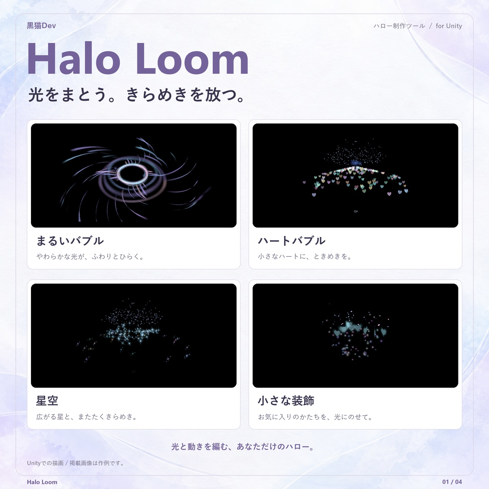
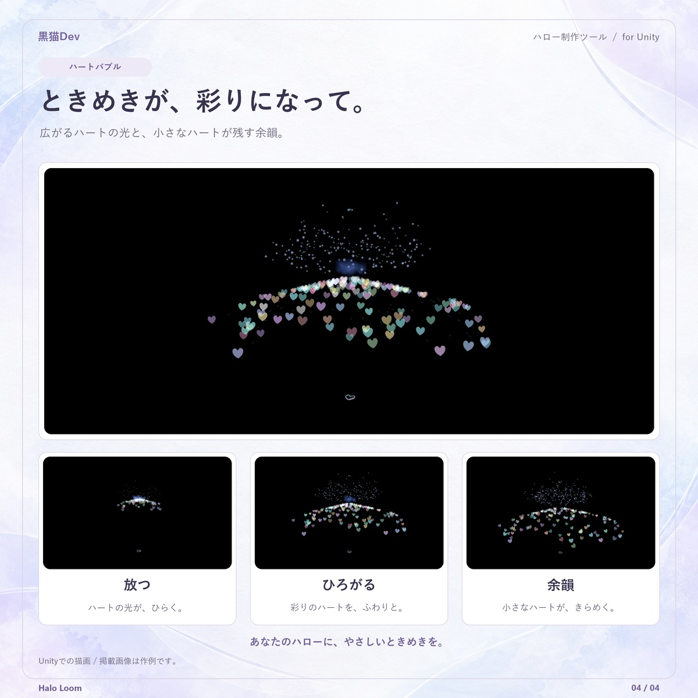
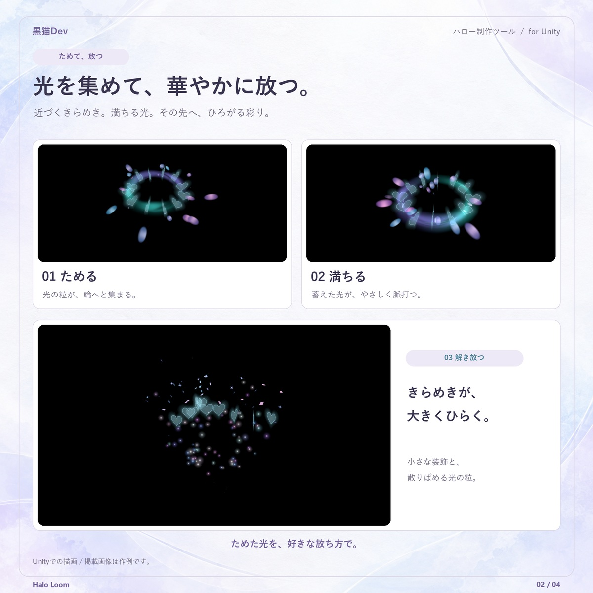
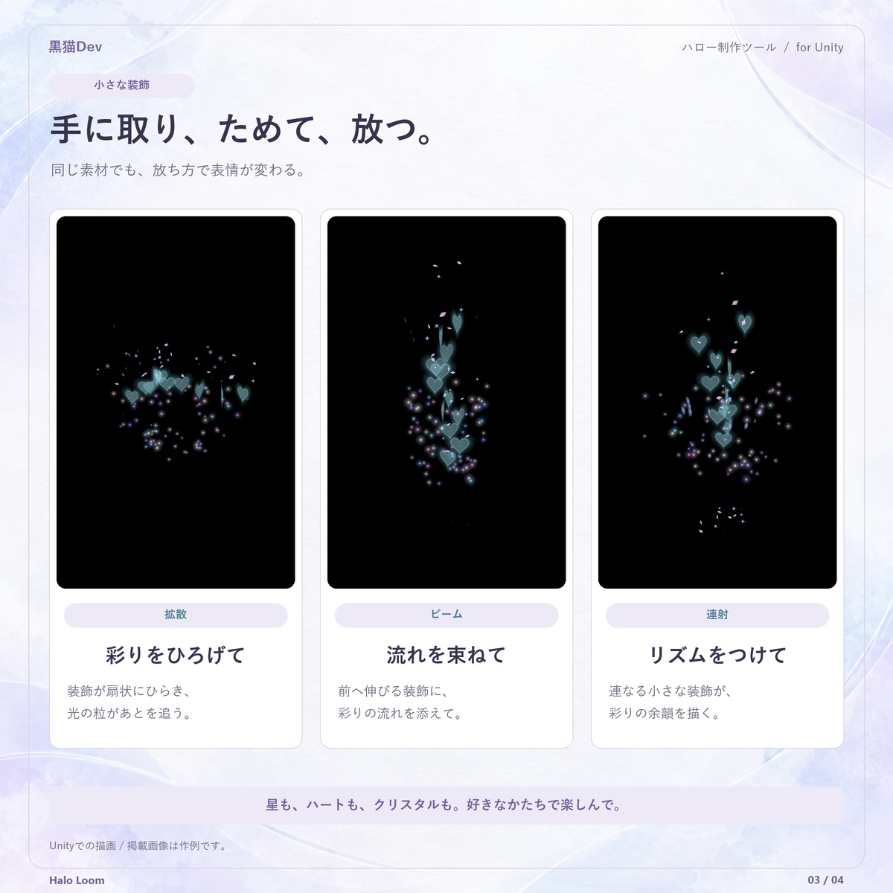

# Halo Loom — 使用說明網站

黒猫Dev Halo Loom の使い方ガイド。日本語を中心に、英語・繁體中文も公開しています。

Halo Loom user guide in Japanese, English and Traditional Chinese. / 黒猫Dev Halo Loom 公開圖文說明，日文優先，提供英文及繁體中文。

網站： https://kuroneko11375.github.io/halo-loom-guide/

商品： https://kuronekodev.booth.pm/items/8914197

## 0.5.1 DEV · 2026-10-18

### 日本語

- 装飾素材のチャージは、内側へ集まる光から、チャージ完了を示す穏やかな脈動へつながります。
- 散射・光束・連射の軌跡を調整し、彩色の噴流と外へ広がる粒子を追加。選んだモデル本体も飛んで戻ります。
- ハート型リングの拡散と余韻は、色とりどりのハートがきらめきます。
- 内蔵 20 種類の装飾と 3 種類の射出を Unity で確認しています。これは DEV 更新です。VRChat Client・ヘッドセット・複数人での表示・GPU 負荷は、この更新では再検証していません。

更新前にバックアップしてください。0.5.0 の現行構造からは、既存 Halo を読み込んで「変更を適用」で 0.5.1 DEV の内容を再生成できます。Controller の GUID は維持されます。シーンを保存し、SDK の Build & Test で確認してください。それ以前の非互換構造は、旧 Halo と確認済み所有データを取り外して再作成します。

### English

- Ornament charging draws light inward, then settles into a gentle ready pulse.
- Scatter, Beam and Volley have distinct paths, colorful jets and outward-spreading particles. The selected models themselves fly out and return.
- The heart-shaped ring scatters colorful, twinkling hearts through its release and lingering particles.
- Unity checks cover all 20 built-in ornaments and all 3 release modes. This is a DEV update; VRChat Client, headset use, multiplayer visibility and GPU cost have not been revalidated for it.

Back up before updating. For the current 0.5.0 structure, load the existing Halo and use Apply Changes to regenerate it with 0.5.1 DEV. Controller GUIDs are preserved. Save the scene and check with the SDK's Build & Test. Earlier incompatible structures need removal of the old Halo and confirmed owned data before recreating.

### 繁體中文

- 小元素蓄力由向內聚光銜接至蓄滿脈動，讓發射時機更容易辨識。
- 調整散射、光束、連射的軌跡，加入彩色噴流與向外擴散粒子；選用的模型本體也會飛出並返回。
- 心形環的散開與尾韻改為多彩愛心，保留逐顆閃爍。
- Unity 檢查涵蓋全部 20 種內建裝飾與 3 種射法。本次為 DEV 更新，尚未重新驗證 VRChat Client、頭盔、多人可見性與 GPU 負載。

更新前請先備份。0.5.0 現行結構升級時，載入既有 Halo 後使用「套用修改」重生成 0.5.1 DEV 的內容，保留 Controller GUID；請自行儲存場景，再以 SDK 的 Build & Test 確認。更早的不相容舊結構才需要移除舊 Halo 與確認自有資料後重建。操作方式與更新注意事項請看[說明網站](https://kuroneko11375.github.io/halo-loom-guide/)。完整文件更新記錄見 [CHANGELOG.md](CHANGELOG.md)。

## 0.5.1 DEV 作例 / Examples / 新版作例

2026-10-18 の Unity Editor 実描画による作例です。画像内は日本語です。 / Actual Unity Editor examples captured on 2026-10-18; text in the images is Japanese. / 2026-10-18 Unity Editor 實際渲染作例，圖內為日文。

| 光ときらめき / Light and sparkle | 多色のハート / Colorful hearts |
| --- | --- |
|  |  |
| 集光・チャージ完了・解放 / Charge and release | 拡散・ビーム・連射 / Three release styles |
|  |  |

## 維護

編輯 `content.mjs` 的三語內容及 `site.css`，執行 `node build.mjs` 重新產生 `index.html`、`en.html`、`zh.html`，三份生成檔一起提交。

GitHub Pages 使用 `main` 分支根目錄，無需安裝依賴或伺服器。圖片與樣式使用相對路徑。頁面不依赖 JavaScript、不使用追蹤器或外部字型。

## 範圍與圖片

- 本儲存庫僅供說明網站，不包含付費 Unity 工具程式碼、Shader 或商品套件。
- `assets` 中既有介面與效果圖為 Halo Loom 實際 Unity 畫面（2026-10-01）；`dev-051-*.jpg` 為 2026-10-18 正式 DEV 的實際效果宣傳圖預覽，僅等比縮小。效果圖是組合範例，不是另外附贈的一鍵預設。
- 介面截圖為日文；畫面中 Avatar 為空的情況是獨立效果展示場景，不代表 Avatar 使用者必須留空。
- 素材權利及工具使用條款以 BOOTH 商品頁為準；此儲存庫不另外授予商品或圖片的再散布授權。
- 製品版說明基準為 Halo Loom 0.5.1 DEV（套件版本 `0.5.1-dev`，2026-10-18）；無料版為獨立版本。截圖保留早期 UI，內文明示可能差異。文件發布不代表額外的相容性或效能驗證。
