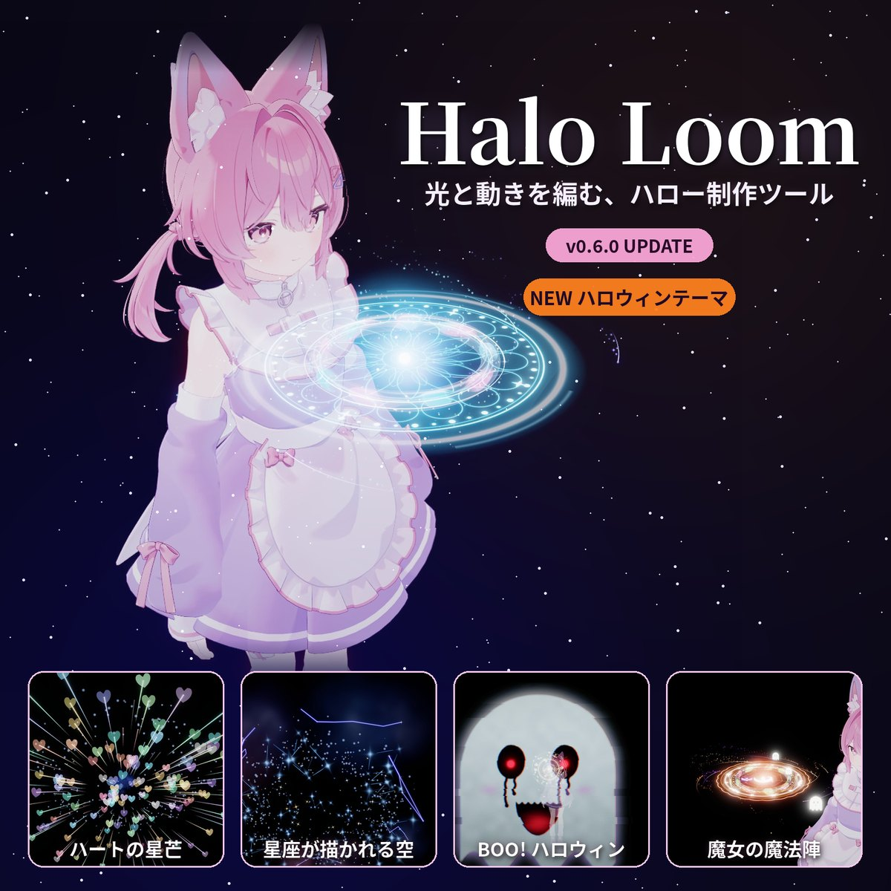

# Halo Loom 0.6.0 — オンラインガイド

黒猫Dev Halo Loom · 日本語 / English / 繁體中文

> [!IMPORTANT]
> **旧版から更新する場合は、先に削除して入れ直してください。**
> バックアップ → 旧版ツールで現在の Halo を削除 → 旧 HaloMaker のツール本体のみ削除 → 新版をインポート → Halo を作り直す。[更新手順](https://kuroneko11375.github.io/halo-loom-guide/#reinstall)
>
> **Updating? Remove first, then reinstall.** [Update steps](https://kuroneko11375.github.io/halo-loom-guide/en.html#reinstall)
>
> **舊版更新請先刪除，再重新安裝。** [詳細步驟](https://kuroneko11375.github.io/halo-loom-guide/zh.html#reinstall)

## ガイド / Guide / 說明

- [日本語](https://kuroneko11375.github.io/halo-loom-guide/)
- [English](https://kuroneko11375.github.io/halo-loom-guide/en.html)
- [繁體中文](https://kuroneko11375.github.io/halo-loom-guide/zh.html)
- [出典・ライセンス / Sources and licenses / 素材出處與授權](https://kuroneko11375.github.io/halo-loom-guide/#credits)
- [BOOTH](https://kuronekodev.booth.pm/items/8914197)

## 維護 / Maintenance

- 本文：`content.mjs`（ja / en / zh-Hant）。版面：`build.mjs`、`site.css`。圖片放大與目錄高亮：`gallery.js`。
- 修改後執行 `node build.mjs`，連同產生的 `index.html`、`en.html`、`zh.html` 一起提交。
- GitHub Pages 使用 main 分支根目錄。無追蹤器、無外部字型、無外部請求。
- 圖片：`assets/v060/`（主視覺、6 張功能圖、PV 與封面）；選單圖示：`assets/icons/`。
- 本儲存庫只放公開說明與宣傳圖，不含產品程式、unitypackage、Avatar 或第三方付費素材。
